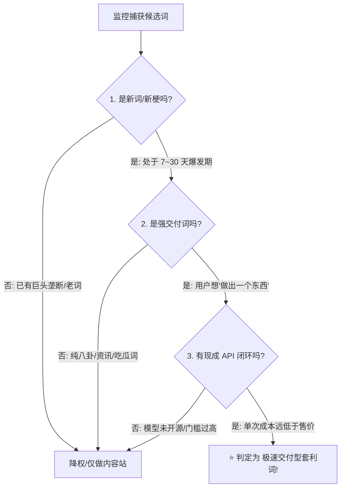

# TrendSpy · 新词极速变现监控标准指南 (NewTrend Monetization Playbook)

> **核心宗旨**：汲取 `hotel lobby ai` 与 `raindance ai` 的实战复盘教训，打破“唯大词论”与“死等 Google SEO”的传统误区。在社媒新梗爆发的最初 24~48 小时，通过 **GEO（AI 搜索推荐）+ 零竞品 EMD + 极简交付工具**，吃透 7 到 30 天的暴利窗口期。

---

## 一、 核心教训与认知重塑

### 1. 传统 SEO 为什么打不过“快闪套利”？
* **传统模式（已失效）**：看规划师月搜、KD 难度、CPC，写文章做站群等 Google 爬虫抓取和外链沉淀，耗时 1~3 个月。此时社媒新梗的热度早已熄灭，或者巨头和成熟站长已全面垄断排名。
* **现代快闪套利（GEO 时代）**：
  * **主战场在 AI 搜索**：终端用户刷到 TikTok 视频后，第一反应是问 ChatGPT / Perplexity / SearchGPT：“这是什么视频？怎么用我的照片做？”
  * **信息真空期红利**：新词爆发的头几天，全网专门解决该需求的网页接近于零。只要你的单页结构清晰、被 AI 爬虫收录，**ChatGPT 就会将其作为首选甚至唯一来源直接推给用户**（实战中 `chatgpt.com` 贡献超 50% 注册与付费！）。

### 2. 真实案例对照（警钟长鸣）
| 案例词 | 搜索体量 | 竞品状态 | 转化表现 | 我们的教训 |
| :--- | :---: | :---: | :---: | :--- |
| **`hotel lobby ai`** | 大（GPTs×0.05） | 头部站长（哥飞等）与官方巨头第一时间占领 | 极高，但竞争极其激烈 | 发现时已处于爆发中后期，大词容易被巨头内卷截流。 |
| **`raindance ai`** | 小（比前者小 20 倍） | **SERP 竞品为 0**（无精准匹配独立站） | **5天 150 单，收入破 $1,300+**，接上支付 10 秒出首单 | **系统因搜索量小而遗漏！小 20 倍的词没有竞品，转化率高达 12%~25%，才是个人开发者的提款机。** |

---

## 二、 最能变现新词的“选词金三角法则”

每次监控扫描出的关键词，必须严格通过以下三道过滤门槛。**三者必须全部为“是”，才判定为【最高星级·极速交付词】**：

1. **是新词吗？（Newness）**
   * 刚在 TikTok / YouTube Shorts / X 冒头，处于 7~30 天生命周期的最初 48 小时；
   * Google SERP 前 10 名**没有**出现以该词命名的 Exact Match 独立交付单页。
2. **是强交付词吗？（Actionable Delivery）**
   * 排除“XXX 怎么读”、“XXX 歌词”、“XXX 谁唱的”等纯资讯词；
   * 锁定 **“做视频 / 换脸 / 运镜 / 滤镜 / 换背景 / 小票卡面”** 等具体产出物意图词（词根通常带 `generator / tool / filter / ai / template`）。
3. **能用现成 AI 接口一键做出来吗？（API Arbitrage）**
   * 存在 Fal.ai、Replicate、Kling、Hailuo、ComfyUI 等成熟 API 或开源工作流；
   * **经济账能算过来**：单次调用成本 $\le \$0.50$，积分售价 $\ge \$4.99$，毛利率保持在 **80%~90%+**。

---

## 三、 让 ChatGPT 极速推荐的“GEO 落地页文案 8 大军规”

要想让 ChatGPT 刚抓到你的网站就愿意在对话中推荐给用户，页面文案必须严格遵循以下 8 条规范（**“用户怎么问 AI，页面就怎么写；第一句就给结论，用具体数字代替形容词”**）：

1. **Title 复述用户向 AI 提出的长尾问句**：
   * 格式：`[趋势名] - Free [输入类型] [交付物] (2026)`
   * 示例：`Raindance AI - Free Two-Photo Video Generator (2026)`
2. **描述写清输入、免费额度、输出与门槛**：
   * 示例：`两张照片、首个视频免费预览、竖版 9:16 适配 TikTok/Reels、无需下载 App 或复杂模板。`
3. **一句话讲清输入和输出（H1）**：
   * 示例：`Two photos. One Raindance video.`（直接把总结句喂给大模型）。
4. **先回答“这是什么”（带具体事实）**：
   * 明确解释流行梗的来源（歌名、原作者、标志性背景、社媒怎么玩），AI 引用事实最喜欢可核验的源头。
5. **步骤与参数全量数字化**：
   * 杜绝“快速、超清、海量”等虚词；
   * 全用数字：`3 个步骤`、`JPG/PNG 不超 10MB`、`15 秒竖版`、`720p/1080p`、`赠送 16 积分`、`单价 $5.99`。
6. **FAQ 一问一答，首句即结论**：
   * Q: `免费吗？` $\rightarrow$ A: `是的，新账号赠送 1 次免费标清预览……`
   * Q: `需要原视频吗？` $\rightarrow$ A: `不需要，只需上传两张清晰正脸照片……`
7. **主动声明风险与边界（正规化心智）**：
   * 不托管受版权保护的音轨、不用官方 logo、声明为第三方粉丝独立生成工具、用户需确认照片所有权。
8. **内置竞品与平替对比页**：
   * 建立子页面或段落：`[关键词] vs CapCut`、`[关键词] Alternative`，拦截寻找免费或网页版平替的意图。

---

## 四、 商业变现与工程防翻车铁律

### 1. 坚决做“一次性积分包”，放弃“订阅制（MRR）”
* **原因**：社媒流行梗是快闪消费，用户只想发一条爆款 TikTok，订阅制会极大提高付款门槛，导致极高的退款率和客诉；
* **定价阶梯**：
  * **入门体验包**：\$4.99 ~ \$5.99（包含 1~2 次完整交付）；
  * **标准创作包**：\$9.99 ~ \$14.99（包含 3~5 次 + 高清去水印）；
  * **起名心理学**：命名用 `Standard Video`、`Creator Pack`，**严禁命名为“1 Video”**（会让用户觉得是阉割缩水版）。
* **免费试用必须设总预算封顶**：限制每日全局免费生成总成本，防止羊毛党脚本打垮账户。

### 2. 工程交付四件套（上线即就绪）
1. **Google 一键登录必须置顶**：
   * 邮箱验证码接口有每日限额，超限会**静默失败**，导致用户卡死；Google 登录零延迟、转化损耗最低。
2. **上线前完整自付一笔走通真实链路**：
   * 绝不因为测试费贵而跳过！必须验证：支付回调 $\rightarrow$ Webhook 触发 $\rightarrow$ API 排队生成 $\rightarrow$ 视频下载。
3. **渠道来源（UTM + Referrer）第一秒埋点**：
   * 必须在用户首次注册时，把来源（ChatGPT / Google / Direct）固化到用户表，算清每一分钱的获客渠道。
4. **生命周期认知：全流程 24 小时内必须上线**：
   * 黄金暴利期只有 **5 ~ 15 天**。手头必须常备 TanStack/Next.js + Cloudflare + Waffo/Stripe 的现成脚手架，遇到新词，2 小时换皮上线。

---

## 五、 TrendSpy 监控自动化执行标准

在后续的每日巡航研报（`newtrend_radar_report.md`）中，系统将强制增加 **【⚡ 极速交付型商业新词精选】** 专属版块，按以下标准严格呈现：

1. **交付品类标注**：明确标注是“双人运镜模版”、“AI 滤镜”、“卡面生成”还是“语音克隆”；
2. **SERP 零竞品标记**：标明 Google 当前是否有专门匹配的单页工具；
3. **GEO 预制资产**：直接提供符合 8 大军规的建议 H1、Title 和落地页核心文案，拿来即用！
